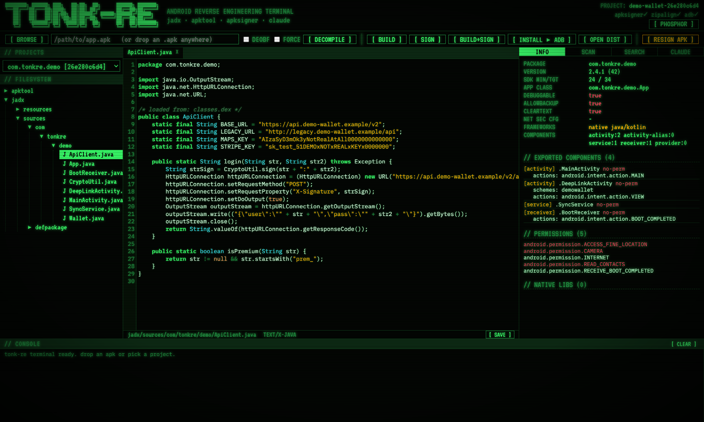
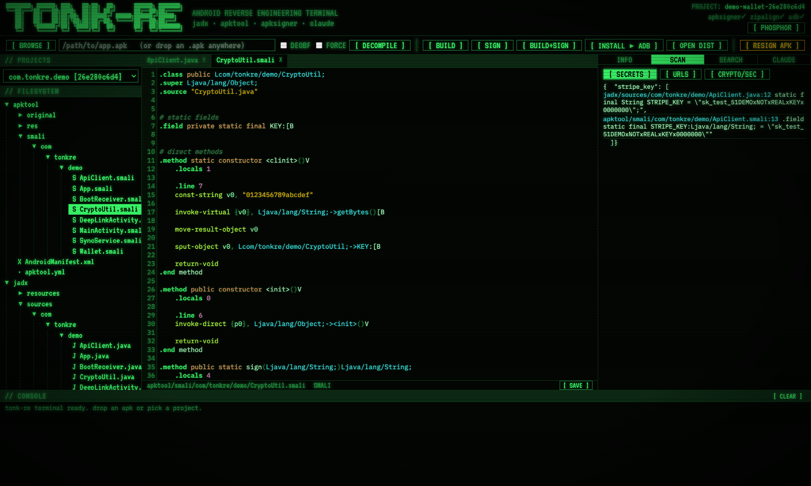
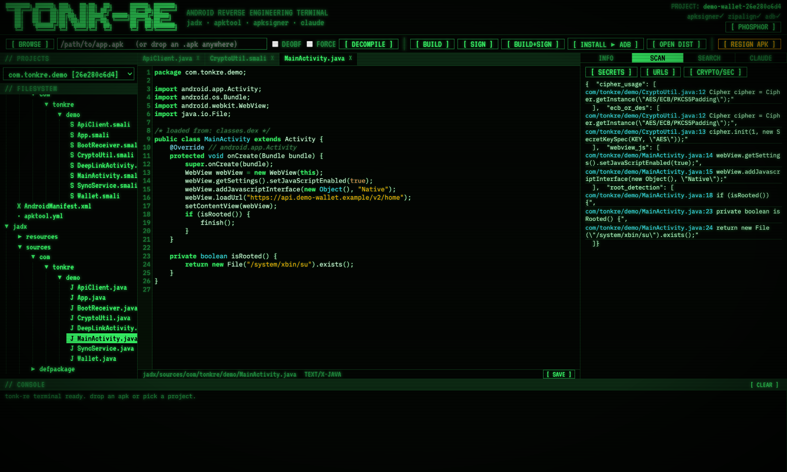
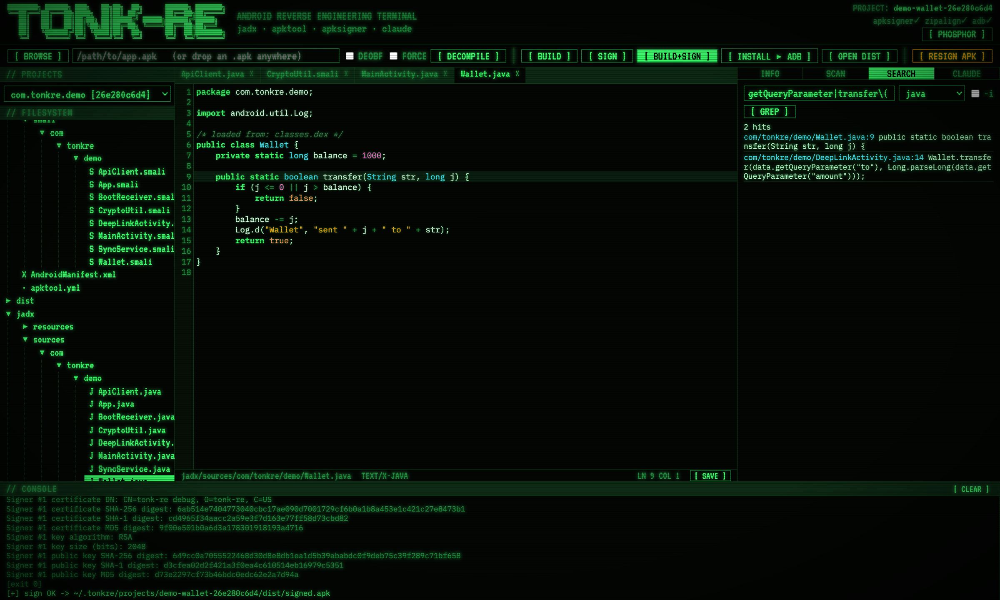
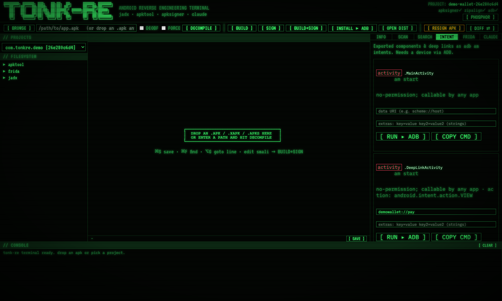
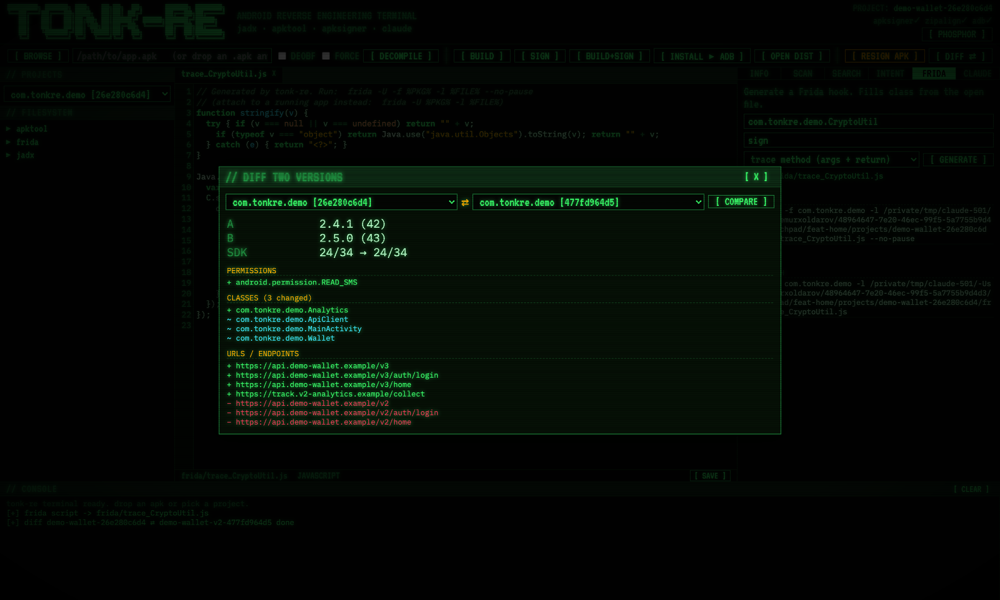
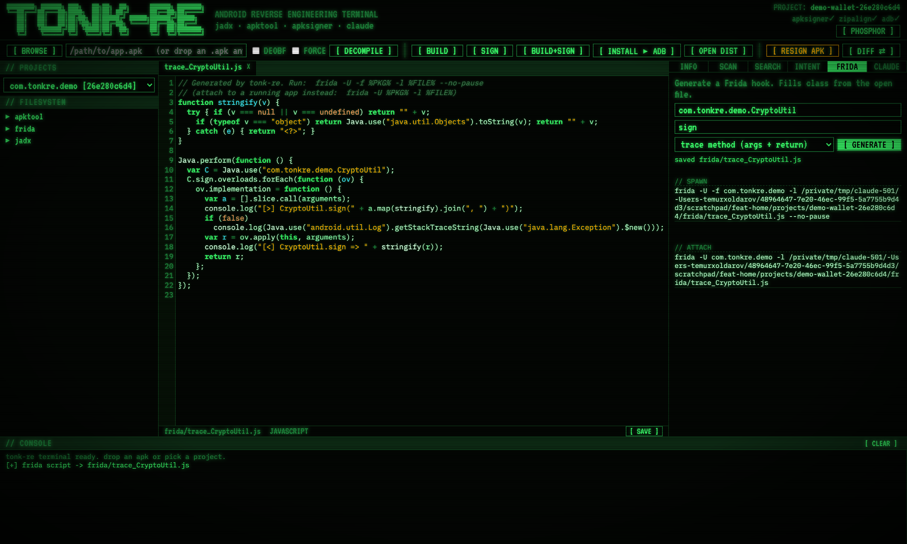
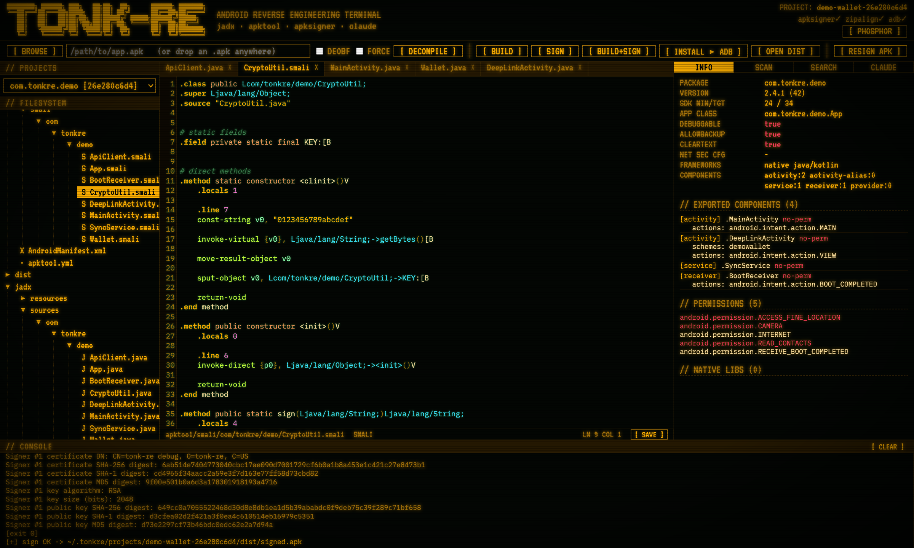

<div align="center">

# TONK-RE

**A retro-terminal GUI for decompiling, inspecting, patching, rebuilding and signing Android APKs — with an AI assistant built in.**

Drop in an `.apk`, read the Java, grep the smali, scan for secrets and insecure crypto, edit, rebuild, and re-sign — all from one green-phosphor CRT interface. Also ships as an MCP server so [Claude Code](https://claude.com/claude-code) can drive the same analysis from your terminal.

Runs on **macOS**, **Windows** and **Linux**.



</div>

---

> [!WARNING]
> **For authorized use only.** Decompile, patch and re-sign only apps you own or have explicit permission to test. You are responsible for complying with the app's license and your local laws.

## Features

- **Decompile** `.apk` / `.xapk` / `.apks` / `.apkm` with [jadx](https://github.com/skylot/jadx) (Java/Kotlin source) and [apktool](https://apktool.org) (manifest, resources, smali) in one click.
- **Manifest attack-surface summary** — package, SDKs, `debuggable` / `allowBackup` / cleartext flags, exported components with their intent actions and deep-link schemes, dangerous permissions (highlighted), native libs, and detected frameworks (Flutter, React Native, Unity, Xamarin, Cordova).
- **Code editor** with syntax highlighting for Java, smali, XML, JSON, JS and YAML. Tabs, find (`⌘F`), go-to-line (`⌥G`), and editable smali/resources.
- **Security sweeps** — one click each for hard-coded secrets (Google/AWS/Stripe/GitHub/Slack keys, JWTs, private keys), URLs/endpoints, and risky API usage (weak crypto, TLS trust overrides, WebView JS bridges, dynamic code loading, root/Frida detection, raw SQL…).
- **Regex search** across Java, smali or resources — click any hit to jump to the exact line.
- **Deep-link / intent tester** — every exported activity/service/receiver and `scheme://host` deep link rendered as a ready-to-fire `adb am` intent, with editable data URI and extras; run it on a connected device or copy the command. No-permission (callable-by-any-app) components are flagged in red.
- **Version diff** — pick two decompiled versions and see added/removed permissions and exported components, added/removed/**changed** classes, added/removed endpoints, framework changes and security-flag flips.
- **Frida hook generator** — generate a hook script for a method or whole class (trace args/return, stacktrace, override a return value) or a universal SSL-pinning / root-detection bypass; saved into the project with ready `frida` spawn/attach commands.
- **Java ⇄ smali bridge** — read a class in clean decompiled Java, then jump straight to its smali (multidex- and inner-class-aware) to patch it and rebuild.
- **Rebuild & sign** — `BUILD` (apktool), `SIGN` (zipalign + apksigner v1–v3), `BUILD+SIGN`, `INSTALL ▸ ADB`, and `RESIGN APK` for any existing APK. A debug keystore is generated automatically.
- **Ask Claude** — a built-in chat panel runs the `claude` CLI read-only inside the project, with your editor selection as context, and links file:line references straight into the editor. The conversation has memory (**+ NEW SESSION** starts fresh), and an editable **pre-prompt** template (saved per machine) wraps every question so you can pin a role/output format (e.g. an OWASP MASVS audit).
- **MCP server** — the same engine is exposed to Claude Code as the `tonk-re` tool set, so you can decompile and audit from any `claude` session.
- **Retro CRT UI** — scanlines, glow, boot sequence, and a green/amber phosphor toggle. Resizable panels.

## Screenshots

| Decompiled source + manifest attack surface | Secret scan on smali |
|---|---|
|  |  |

| Crypto / security scan | Rebuild + sign (apksigner verified) |
|---|---|
|  |  |

| Deep-link / intent tester | Version diff |
|---|---|
|  |  |

| Frida hook generator | Amber phosphor mode |
|---|---|
|  |  |

## Requirements

| Tool | What for | macOS | Windows | Linux |
|---|---|---|---|---|
| [uv](https://docs.astral.sh/uv/) | runs the app (manages Python + deps) | `curl -LsSf https://astral.sh/uv/install.sh \| sh` | `irm https://astral.sh/uv/install.ps1 \| iex` | same as macOS |
| JDK (Java) | apktool, apksigner, keytool | `brew install openjdk` | `winget install Microsoft.OpenJDK.21` | `sudo apt install default-jdk` |
| [jadx](https://github.com/skylot/jadx) | Java/Kotlin decompiler | `brew install jadx` | `scoop install jadx` | [releases](https://github.com/skylot/jadx/releases) |
| [apktool](https://apktool.org) | resources + smali | `brew install apktool` | `scoop install apktool` | `sudo apt install apktool` |
| Android SDK build-tools + platform-tools | `apksigner`, `zipalign`, `adb` | Android Studio ▸ SDK Manager (auto-detected) | same | same |
| [frida](https://frida.re) (optional) | *running* generated hooks (generation needs nothing) | `pipx install frida-tools` | `pipx install frida-tools` | `pipx install frida-tools` |
| Chrome / Edge / Brave / Chromium | app-window mode (optional) | optional | Edge is built in | optional |
| zenity *or* kdialog | the `BROWSE` file dialog | built in | built in | `sudo apt install zenity` |

Everything except uv is optional to *start* the app — TONK-RE probes for each tool on launch. The boot screen shows an `[ OK ]` / `[MISSING]` check for each, a **setup banner** lists any missing required tool with the exact install command for your OS, and if you try an action whose tool is missing (e.g. DECOMPILE without jadx) you get a clear message with the install command instead of an error. jadx + apktool are needed to decompile; a JDK (keytool) + apksigner/zipalign to sign; adb to install; frida only to *run* generated hooks.

> **macOS note:** only macOS gets the native Dock app (`.app`). Windows and Linux run in an app window of your Chromium-family browser, or a normal browser tab.

## Install

Clone, then run the installer for your OS.

```sh
git clone https://github.com/xaldarof/tonk-re.git
cd tonk-re
```

**macOS / Linux**

```sh
./install.sh
```

**Windows (PowerShell)**

```powershell
powershell -ExecutionPolicy Bypass -File install.ps1
```

The installer:

- checks for required tools and prints the exact install command for anything missing,
- creates the `tonkre-gui` (GUI) and `tonkre` (CLI) launchers in `~/.local/bin`,
- installs the Claude Code skill, and
- registers the `tonk-re` MCP server with Claude Code (if the `claude` CLI is present).

On Windows it also adds a **TONK-RE** desktop shortcut.

### macOS: Dock app

To get a real Dock app with its own icon:

```sh
./macos/build_app.sh --dock
```

This builds `~/Applications/TONK-RE.app` and pins it to your Dock. Launch it from the Dock, Launchpad or Spotlight; the window is native (not a browser tab) and quitting it (`⌘Q`) stops the background server. Omit `--dock` to build the app without pinning.

## Usage

### GUI

```sh
tonkre-gui             # opens an app window
tonkre-gui --browser   # opens in a normal browser tab instead
```

Or launch **TONK-RE** from the Dock (macOS).

1. **Load an APK** — drag an `.apk` onto the window, or click `BROWSE`, or paste a path and hit `DECOMPILE`. Results are cached by file hash, so re-opening the same APK is instant. Already-decompiled apps appear in the **PROJECTS** dropdown.
2. **Explore** — use the file tree (left) to read decompiled Java under `jadx/sources/` or smali/resources under `apktool/`. The **INFO** panel (right) summarizes the manifest and attack surface — click an exported component to jump to its handler.
3. **Scan** — the **SCAN** tab runs secret / URL / crypto-security sweeps; the **SEARCH** tab is a regex grep over Java, smali or resources. Click any result to open it at that line.
4. **Patch** — edit smali or resources in the editor and `⌘S` to save.
5. **Rebuild** — `BUILD` recompiles with apktool, `SIGN` signs it, `BUILD+SIGN` does both, `OPEN DIST` shows the output (`<project>/dist/signed.apk`), and `INSTALL ▸ ADB` pushes it to a connected device.
6. **Ask Claude** — the **CLAUDE** tab answers questions about the app and cites file:line; select code in the editor first to send it as context. Use **+ NEW SESSION** to reset the conversation, and **PRE-PROMPT** to edit the saved template (with `{question}` / `{context}` placeholders) that wraps every question.

> Only smali and resource edits are recompiled into the APK. Edits to the decompiled **Java** are for reading/reference — the app reminds you when you save one.

### CLI

The `tonkre` command exposes the core engine headlessly:

```sh
tonkre decompile /path/to/app.apk      # -> prints the project name + manifest summary
tonkre projects                        # list decompiled projects
tonkre info     <project>              # manifest attack-surface summary
tonkre secrets  <project>              # hard-coded secrets
tonkre urls     <project>              # endpoints
tonkre security <project>              # crypto / security findings
tonkre search   <project> <regex> [java|smali|resources|all]
tonkre intents  <project>              # exported components + deep links as adb am intents
tonkre diff      <project_a> <project_b>   # diff two decompiled versions
tonkre frida    <project> [class] [method] [template]   # print a Frida hook script
tonkre smali    <project> <class>      # smali path(s) for a Java class
```

### With Claude Code

After install, the `tonk-re` MCP server is registered. In any `claude` session you can simply ask:

```
decompile ~/Downloads/app.apk and audit it for hard-coded secrets and insecure crypto
```

Claude will call the `tonk-re` tools (`decompile_apk`, `apk_info`, `find_secrets`, `find_crypto_and_security`, `search_code`, `read_class`, `xrefs`, …) and report back with file:line evidence. A bundled skill guides the workflow.

## Configuration

Set these environment variables before launching:

| Variable | Default | Purpose |
|---|---|---|
| `TONKRE_PORT` | `7777` | port for the GUI server (GUI mode only; the Dock app picks a random free port) |
| `TONKRE_HOME` | `~/.tonkre` | where projects, uploads and the debug keystore live |
| `ANDROID_HOME` / `ANDROID_SDK_ROOT` | OS default | Android SDK location (for apksigner/zipalign/adb) |

Decompiled projects live in `$TONKRE_HOME/projects/`; the auto-generated signing key is `$TONKRE_HOME/debug.keystore`.

## How it works

```
         ┌──────────────┐        ┌──────────────┐
  APK ──▶ │   gui.py     │  HTTP  │   ui.html    │  ← retro CRT front-end
         │ (127.0.0.1,  │◀──────▶│ (CodeMirror) │
         │  token-auth) │        └──────────────┘
         └──────┬───────┘
                │ imports
         ┌──────▼───────┐
         │  server.py   │  ← core engine + MCP server
         └──────┬───────┘
     ┌──────────┼───────────┬───────────┐
   jadx      apktool    apksigner /    claude CLI
 (sources)  (smali/res)  zipalign       (read-only)
```

- **`server.py`** — the decompile/scan/search engine, usable three ways: imported by the GUI, run as a CLI (`cli` subcommand), or run as an MCP server (default).
- **`gui.py`** — a stdlib HTTP server bound to `127.0.0.1` with a per-launch random token; it streams long-running jobs (decompile/build/sign/claude) line-by-line to the console. Also handles OS integration (file dialog, "reveal in folder", app window, native macOS window).
- **`ui.html`** — a single-file front-end (CodeMirror + vanilla JS), no build step.

### Security model

The server listens only on `127.0.0.1` and every API call requires a secret token generated fresh at launch (printed in the URL). Other websites in your browser can't reach it without the token. Nothing is uploaded anywhere — all analysis is local. The `claude` panel runs the CLI with `--allowedTools Read,Grep,Glob` (read-only) scoped to the project directory.

## Project layout

```
tonk-re/
├── server.py          core engine + MCP server + CLI
├── gui.py             local web server + OS integration
├── ui.html            retro-terminal front-end
├── install.sh         macOS / Linux installer
├── install.ps1        Windows installer
├── macos/
│   ├── build_app.sh   builds TONK-RE.app (+ --dock)
│   └── make_icon.py   renders the CRT app icon
├── skill/SKILL.md     Claude Code skill
└── docs/screenshots/
```

## License

[MIT](LICENSE) © Temur ([@xaldarof](https://github.com/xaldarof))
